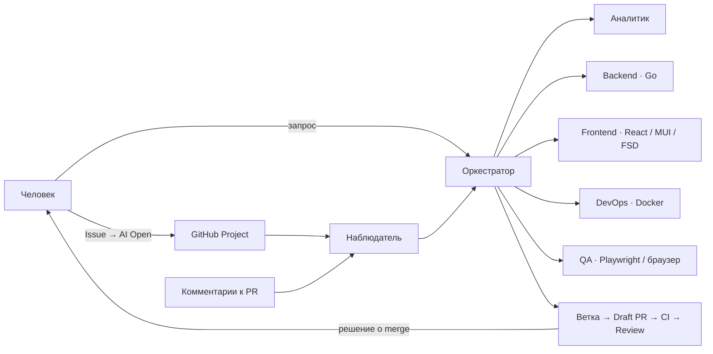
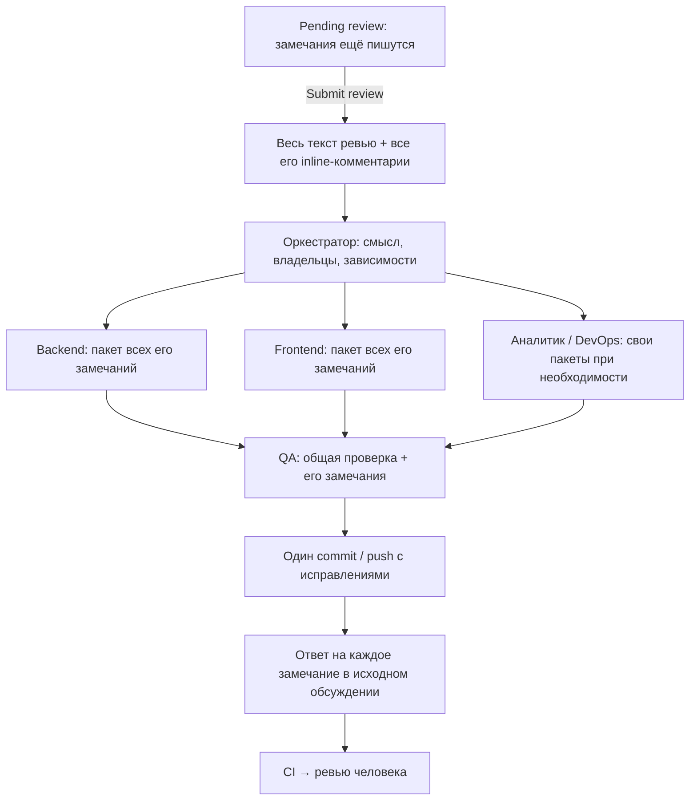

# Небольшая AI-команда для GitHub

Минимальный старт: один оркестратор, пять специалистов и один наблюдатель.
GitHub хранит задачи, обсуждения и код. Человек выбирает задачи и сливает PR.
Приложение Go + React здесь не создаётся: это переносимый каркас команды.



| Где | Что находится |
| --- | --- |
| `AGENTS.md` | Общие правила и роль оркестратора при прямом запросе в Codex |
| `.codex/agents/*.toml` | Пять коротких нативных ролей; **gpt-6.1-sol**, QA — **low**, остальные — **high** |
| `harness/observer.py` | Опрос GitHub, SQLite-очередь, ограниченный запуск Codex и публикация результата |
| `harness/config.example.toml` | Репозиторий, Project, доверенные авторы, лимиты и проверки |
| `harness/compose.yaml` | Необязательный постоянный процесс наблюдателя в Docker |
| `.github/workflows/ci.yml` | Проверки каркаса; заменить/дополнить проверками своего приложения |

Оркестратор запускает только нужных специалистов, последовательно. Все события сначала
попадают ему. Наблюдатель — обычная программа: модель работает только при наличии задачи.
В режиме наблюдателя Git-команды и публикацию выполняет программа по результату оркестратора.

QA работает на `low`: один основной проход и одна адресная перепроверка, суммарно до 10 минут.
Оркестратор сохраняет использованные проходы и время между вызовами; лимиты заданы инструкциями,
а не отдельным таймером процесса QA. Общий жёсткий `job_timeout_seconds` наблюдателя может остановить работу раньше
(в демонстрационном конфиге — 240 секунд на всё задание). Исчерпание бюджета не означает успешную приёмку.
Ошибки сервера, сломанный интерфейс, отсутствие необходимой валидации и риски для доступа или данных
возвращаются разработчикам одним пакетом. Независимые некритичные недоработки можно вынести в связанные Issue
в `Inbox`, явно перечислив невыполненные требования. При запуске наблюдателем они передаются в `deferred_issues`;
программа создаёт Issue до публикации результата, не запускает их и не закрывает исходную задачу досрочно.
При прерванной публикации сохраняется список в `state_dir/deferred/`; неизвестный исход создания Issue
или изменение списка при повторе требуют разбора, а не слепого повторного создания.

## Жизненный цикл

`Inbox → AI Open → In Progress → Review → Done`; препятствие переводит задачу в `Blocked`.

- Нечёткий прямой запрос: оркестратор → аналитик → короткая Issue с критериями приёмки.
  Уточнение требований само по себе не запускает разработку.
- Issue с меткой `ai:managed` в **AI Open**: ветка `ai/<номер>` → специалисты → проверки → Draft PR.
  После успешного CI на проверенном коммите наблюдатель переводит PR в Ready и задачу в Review.
- Опубликованное ревью управляемого PR: весь пакет → оркестратор → пакеты по ролям →
  общая проверка QA → одна публикация исправлений и ответы в исходных обсуждениях.
  Вопрос получает ответ; подтверждённый дефект — исправление; несогласие — аргументы.
  Агент не закрывает спорные обсуждения и не считает каждый комментарий приказом переписать код.
- Merge выполняет человек. `Closes #N` закрывает Issue при слиянии в основную ветку;
  включите стандартный workflow Project «Item closed → Done» либо поставьте Done вручную.

Запускаются только задачи выбранного репозитория. Для PR нужны `ai:managed`, ветка `ai/*`
в том же репозитории и автор комментария из `trusted_users`. `AI:` — удобный заголовок,
а не разрешение на запуск. Метки `role:analyst/backend/frontend/qa/devops` подсказывают маршрут.
Обычные, inline-комментарии и текст review поддерживаются. Собственные ответы не запускают цикл.

### Как обрабатывается ревью



Стрелки показывают передачу работы; специалисты работают последовательно в одной ветке.
Оркестратор учитывает смысл замечания, а не только путь файла: вопрос о бизнес-правиле в
React-компоненте может относиться к аналитику. У общего замечания один ответственный;
зависимые изменения выполняются после согласования контракта.

У каждого ID замечания обязательны владелец и решение: `fixed`, `answered`, `disagreed`
или `needs_input`. Пропущенные/повторные/посторонние ID останавливают публикацию.
Вопросы и несогласие не меняют код. При недостающем бизнес-решении пакет становится
Blocked: вопросы публикуются, локальные правки сохраняются без объявления их готовыми.

Pending review, включая его inline-комментарии, не попадает ни в очередь, ни в контекст
агента. Публикация — [GitHub Submit review](https://docs.github.com/en/rest/pulls/reviews#submit-a-review-for-a-pull-request).
Повторный опрос не запускает ту же версию замечания снова. Новые замечания во время работы
попадут в следующий пакет; текущий пакет не расширяется. Редактирование уже выполняемого
замечания останавливает публикацию устаревшего ответа. Обычный комментарий вне review
обрабатывается отдельным небольшим пакетом с контекстом PR.

Старая SQLite-очередь сохраняется: завершённые/заблокированные версии не повторяются,
неисполненные одиночные события перегруппировываются. `superseded` означает заменённый
пакет, который больше не будет выполняться. Ответы имеют метку версии замечания,
поэтому повторная отправка того же ответа не создаёт дубликат.

## Первый запуск

Нужны Linux/macOS, Python 3.11+, Git, GitHub CLI и актуальный Codex CLI с custom agents.
Для проверки использованы Codex 0.162.0-alpha.17.2 локально и образ с Codex 0.163.0.

1. Создайте **отдельный чистый clone** рабочего репозитория. Скопируйте каркас в него и закоммитьте.
2. Выполните `gh auth login --scopes project` и `codex login` на машине наблюдателя.
3. Создайте Project, свяжите с репозиторием. Поле должно называться **Status**, варианты:
   `Inbox`, `AI Open`, `In Progress`, `Review`, `Blocked`, `Done`.
   Создайте метки `ai:managed` и `ai:paused`.
4. Скопируйте конфигурацию и задайте репозиторий, Project, доверенные логины и команду проверки:

```bash
cp harness/config.example.toml harness.toml
python3 harness/observer.py --config harness.toml --scan-only
python3 harness/observer.py --config harness.toml --once --max-seconds 300
```

`--scan-only` читает GitHub и сохраняет очередь; не запускает модель и не публикует.
`--once` делает один опрос и максимум одну задачу. Без этих флагов работают лимиты
`--max-jobs` (по умолчанию 1), `--max-seconds` (600) и `job_timeout_seconds`.
Время проверок/API может добавиться к бюджету модели. Новый опрос после CI завершает переход в Review.
Необязательный `base_branch` нужен для изолированного smoke-теста; обычно используется default branch.

`check_command` запускается без shell и обязан завершиться успешно перед публикацией.
`required_checks` перечисляет реальные имена CI jobs. У приложения здесь должны быть его тесты,
проверка OpenAPI и сборка frontend; текущий `team-check` проверяет только сам каркас.

## Пауза и восстановление

- Поставьте `ai:paused` на Issue или PR. Наблюдатель проверяет паузу во время работы примерно каждые
  10 секунд и перед публикацией; ошибку GitHub API считает причиной остановиться.
- `touch .state/PAUSE` останавливает весь наблюдатель; удаление этого файла снимает общую паузу.
  При другом `state_dir` файл находится там. `docker compose -f harness/compose.yaml stop` останавливает контейнер.
- После сбоя изучите `state_dir/runs/`, сохранённую ветку и `--scan-only` вывод.
  Незакоммиченные изменения не удаляются. Исправьте/сохраните их, снимите паузу,
  верните Issue в AI Open и выполните `--once --retry '<ключ события>'`.
  Комментарий к PR также можно отредактировать: новая версия создаст новое событие.

SQLite сохраняет обработанные события между перезапусками. Прерванная задача становится Blocked,
без автоматического повторного исполнения. Файловая блокировка не допускает двух процессов
на одном checkout. Используйте один постоянный `state_dir`; это не распределённая очередь.

## Постоянная работа в Docker

**На машине smoke-теста sandbox Codex внутри Docker заблокирован:** `bwrap: No permissions
to create a new namespace`. Сборка образа и опрос GitHub из него прошли; выполнение модели
в контейнере здесь не подтверждено. Приведённый ниже режим исполнения требует Docker host,
на котором работает sandbox Codex. Проверенный вариант на этой машине — нативный CLI:

```bash
python3 harness/observer.py --config harness.toml --max-jobs 100000 --max-seconds 86400
```

Для работы дольше суток этот процесс должен перезапускаться менеджером сервисов.
Автозапуск в системе пользователя каркас не устанавливает.

Образ работает непривилегированным пользователем, без Docker socket. Для собственного приложения
DevOps отдельно готовит dev (зависимости), test (весь стек + тестовые данные) и prod.

Создайте отдельный `harness.toml` с `workspace="/workspace"`, `state_dir="/state"`.
Укажите абсолютные пути через `HARNESS_CONFIG`, `HARNESS_WORKSPACE`, `HARNESS_GH_CONFIG`
и `HARNESS_CODEX_AUTH` (файл авторизации Codex). Они должны быть доступны UID 1000.
GH-конфигурация монтируется только для чтения; файл Codex допускает обновление сессии.
Учётные данные остаются вне Git и образа. Не передавайте их в Issue или чат.
Если `gh` хранит токен в системном keyring, одного монтирования конфигурации недостаточно:
перед запуском выполните `export GH_TOKEN="$(gh auth token)"`, после запуска — `unset GH_TOKEN`.
Токен будет в окружении контейнера, доступном его владельцу; модель его не наследует.

Для Docker используйте HTTPS remote в выделенном clone и credential helper
`git config credential.helper '!gh auth git-credential'`: SSH-ключи в контейнер не монтируются.
Проверьте доступ внутри контейнера и поддержку sandbox Codex на своём Docker host.

```bash
docker compose -f harness/compose.yaml build
docker compose -f harness/compose.yaml run --rm observer --config /config/harness.toml --scan-only
docker compose -f harness/compose.yaml up -d
docker compose -f harness/compose.yaml logs -f
```

Процесс перезапускается после суточного лимита; очередь живёт в named volume.
Машина должна быть включена. В демонстрации постоянный сервис не включается.

## Границы контроля

Роли — инструкции, **не разграничение прав ОС**. Локальные агенты работают с правами процесса.
Текст Issue/комментария не может отменять правила; это также проверяемое поведение модели,
а не гарантия изоляции от любого вредоносного ввода. Секреты GitHub не передаются в prompt.
Модель не выполняет merge, force-push или production deploy; наблюдатель не содержит этих действий.

Для независимой защиты используйте отдельную учётную запись бота и GitHub ruleset:
PR + обязательный CI + одобрение человека, без bypass у бота. С аккаунтом владельца разделения прав нет.
В приватном sandbox GitHub отказал во включении branch protection из-за тарифа;
**защита main на сервере пока не включена**. Репозиторий не делался публичным.
