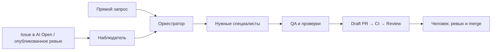

# AI-команда для GitHub

Самостоятельный Python harness для работы над приложением: оркестратор, шесть специалистов и диспетчер с настраиваемым пулом воркеров. Несколько независимых Issue выполняются параллельно в отдельных worktree.

Архитектура, запуск, восстановление и тесты пакета: [harness/README.md](harness/README.md).
Задачи и обсуждения хранятся в GitHub. Человек выбирает работу, проверяет PR и выполняет слияние.
Каркас устанавливает инструкции и инструменты команды; структуру приложения агенты создают по мере задач.

## Быстрый старт

Нужны Linux/macOS, Python 3.11+, Git, GitHub CLI и Codex CLI с поддержкой custom agents.
Заранее создайте GitHub Project и авторизуйтесь на машине, где будет работать команда:

```bash
gh auth login --scopes project
codex login
```

Внутри репозитория **приложения** запустите установку, заменив ссылку на свой Project:

```bash
curl -fsSL https://raw.githubusercontent.com/maestrolix/ai-team-harness-sandbox/main/install.sh -o /tmp/ai-team-install.sh &&
sh /tmp/ai-team-install.sh --project https://github.com/users/OWNER/projects/NUMBER
```

Для организации используйте `https://github.com/orgs/ORG/projects/NUMBER`.
Нужны права записи в репозиторий и Project; в репозитории должны быть включены Issues.
Установщик определяет репозиторий по `origin` (GitHub.com, HTTPS или SSH), затем:

- добавляет правила в `AGENTS.md`, шесть ролей в `.codex/agents/`;
- создаёт локальный `harness.toml`, добавляет его и `.state/` в `.gitignore`;
- связывает Project с репозиторием, добавляет недостающие статусы и метки команды.

Существующие инструкции, статусы и задачи сохраняются. Отличающийся файл роли
останавливает установку до записей в GitHub. Повторный запуск сохраняет существующий `harness.toml`;
это установка, а не автоматическое обновление изменённых ролей. Runtime, README, CI и Docker-файлы каркаса в приложение не копируются.

Установите runtime отдельно (из checkout этого репозитория):

```bash
python3 -m venv .venv
.venv/bin/python -m pip install ./harness
.venv/bin/harness --help
```

Далее команды `harness` предполагают активированное окружение. Установщик также выводит команду установки runtime по точному SHA.

По умолчанию скачивается `main`. Чтобы закрепить версию, скачайте скрипт по SHA вместо `main`
и передайте тот же `--ref SHA`. Установщик не делает commit/push и не запускает задачи.

## Настройки приложения

Перед запуском наблюдателя заполните проверки в `harness.toml`. Их можно передать сразу при установке:

```bash
sh /tmp/ai-team-install.sh --project https://github.com/users/OWNER/projects/NUMBER \
  --check-command 'make check' --required-check backend --required-check frontend
```

`make check`, `backend` и `frontend` здесь — примеры. Укажите реальные команды и имена CI jobs своего приложения.
При повторной установке меняйте уже существующий конфиг вручную. [Пример конфига](harness/config.example.toml).

| Настройка | Назначение |
| --- | --- |
| `check_command` | Команда и аргументы без shell. При пустом списке публикация изменений заблокирована |
| `required_checks` | Имена CI jobs, которые должны успешно завершиться на проверенном SHA. Без них PR остаётся Draft |
| `trusted_users` | Логины, чьи комментарии к PR обрабатывает наблюдатель; установщик добавляет текущего пользователя `gh` |
| `workspace`, `state_dir` | Исходный clone и постоянное состояние с worktree; пути относительно конфига |
| `workers` / `--workers` | Число одновременно выполняемых независимых задач; по умолчанию 1 |
| `environment_mode` | `shared` — один воркер; `isolated` — приложение подготовлено к параллельным окружениям |
| `poll_seconds` | Интервал опроса GitHub, по умолчанию 60 секунд |
| `job_timeout_seconds`, `check_timeout_seconds` | Общий бюджет задачи и предел команды проверки: 1800 и 300 секунд |

Проверки должны покрывать изменённое поведение приложения, включая API и frontend, когда они затронуты.
CI самого каркаса не заменяет проверки приложения. Токены в конфиг и Git не записывайте.

## Два способа работы

**Прямой запрос.** Откройте приложение в новом чате Codex. Оркестратор читает `AGENTS.md`, уточняет задачу
через аналитика при необходимости и привлекает нужных специалистов. Подтвердите доверие папке,
если клиент запросит его: [локальные настройки загружаются для доверенных проектов](https://learn.chatgpt.com/docs/config-file/config-basic).

**Через GitHub.** Сохраните установленные файлы обычным PR и выполните слияние в default branch:
от неё наблюдатель создаёт ветки задач в отдельных worktree. Для наблюдателя используйте отдельный чистый clone приложения
с доступом Git на чтение и push. Скопируйте туда локальный `harness.toml` или повторите установку.
Из корня этой рабочей копии:

```bash
# Прочитать события и состояние очереди, без модели и публикации в GitHub
harness run --config harness.toml --scan-only

# Один пакет с одним воркером
harness run --config harness.toml --once --workers 1

# Три задачи одновременно: предварительно настройте environment_mode = "isolated"
harness run --config harness.toml --workers 3
```

После CI нужен следующий опрос для перевода PR в Ready. Для работы 24/7 настройте перезапуск процесса
менеджером сервисов; установщик автозапуск не создаёт. Машина должна оставаться включённой.
Без лимитов процесс работает до остановки. `--max-seconds` ограничивает приём новых задач;
каждая принятая задача завершается в пределах собственного `job_timeout_seconds`.
`--once` выполняет один пакет до числа воркеров. Для параллельных задач нужны независимые
окружения приложения: отдельные данные, БД и порты. Подробности — в [инструкции harness](harness/README.md#изоляция-окружений).

## Работа с задачами и ревью

`Inbox → AI Open → In Progress → Review → Done`; препятствие — `Blocked`.

1. Создайте Issue с целью, границами и критериями приёмки: [короткий пример](examples/issue-example.md).
2. Добавьте её в выбранный Project, поставьте `ai:managed` и переведите в `AI Open`.
3. Команда выполнит задачу в ветке `ai/*`, проведёт проверки и откроет Draft PR с префиксом `AI:`.
4. После успешных обязательных CI jobs наблюдатель переведёт PR в Ready, а Issue — в `Review`.
5. Проведите ревью и выполните merge. `Closes #N` закрывает Issue; `Done` поставьте вручную
   или настройте workflow Project «Item closed → Done».

Метки `role:analyst`, `role:backend`, `role:frontend`, `role:fullstack`, `role:qa`, `role:devops` подсказывают исполнителя.
Диспетчер назначает независимые события свободным воркерам. Внутри каждой задачи оркестратор
вызывает специалистов последовательно, в одной ветке. Одна Issue/PR не выполняется двумя воркерами одновременно.

Прямое поручение аналитику без ссылки или Issue с просьбой создать/расписать задачи заканчивается подготовкой Issue.
По умолчанию это новая общая задача и задачи нужных ролей: frontend + backend + QA вместе с общей дают четыре.
Явное «только frontend и backend» даёт две, «только fullstack» — одну, без дополнительных общей и QA.
Профильные задачи ссылаются на общую, когда она есть, и исходное поручение. Новые задачи остаются в `Inbox`;
для запуска через наблюдатель человек выбирает нужные задачи и переводит их в `AI Open`.
Наблюдатель публикует подготовленный набор без реализации и PR; исходное поручение переходит в `Review`.
Повтор после сбоя использует сохранённый набор в `.state/planned/` и не создаёт те же Issue заново.



Опубликованное ревью обрабатывается целиком: оркестратор распределяет замечания по ролям пакетами
с учётом смысла и зависимостей. Специалист отвечает на вопрос, исправляет подтверждённую ошибку
или аргументирует несогласие. Исправления публикуются вместе, ответы — в исходных обсуждениях.
Спорные обсуждения не закрываются автоматически.
Pending review не обрабатывается; обычный комментарий вне review образует отдельный пакет.
Новые замечания идут следующим пакетом, изменение уже обрабатываемого замечания останавливает устаревший ответ.

Для обработки PR нужны метка `ai:managed`, ветка `ai/*` в том же репозитории и автор замечаний
из `trusted_users`. Один префикс `AI:` работу не запускает. Чтение очереди само по себе модель не вызывает.

## Роли и договорённости

Внутри каждого воркера все роли используют `gpt-6.1-sol`: QA — `low`, остальные — `high`.

| Роль | Ответственность и рабочая область |
| --- | --- |
| [Оркестратор](AGENTS.md) | Задача, порядок работы, координация ветки и PR, отчёт человеку |
| [Аналитик](.codex/agents/analyst.toml) | Бизнес-требования в Issue; документы в `docs/`, когда нужны |
| [Backend](.codex/agents/backend.toml) | Go, API и бизнес-логика в `application/backend/` |
| [Frontend](.codex/agents/frontend.toml) | TypeScript, React, MUI, FSD в `application/fronted/`; переиспользование компонентов |
| [Fullstack](.codex/agents/fullstack.toml) | Небольшой сценарий в API и интерфейсе: обе папки приложения и `docs/api.json` |
| [DevOps](.codex/agents/devops.toml) | Docker-окружения в `deployment/`; CI на штатном месте |
| [QA](.codex/agents/qa.toml) | Бизнес-сценарии через Playwright/браузер или API; без исправления кода приложения |

Изменение только API или интерфейса получает профильный специалист. Один небольшой сценарий на обеих сторонах,
например фильтр в существующем списке, выполняет fullstack. Он читает технические правила backend и frontend
из их файлов, проверяет совместную работу и сообщает оркестратору, если задачу нужно разделить.
Сложную бизнес-логику и существенные изменения архитектуры, прав доступа или данных выполняют профильные специалисты.
После fullstack обязательная повторная проверка backend/frontend не добавляется; QA и ревью человека сохраняются.

Агенты начинают с относящихся к задаче файлов своей области и расширяют поиск только при необходимости.
Backend или fullstack после изменения API полностью генерирует `docs/api.json` и передаёт его вместе с кодом.
Frontend читает нужные операции из контракта текущей ветки; вручную этот файл не редактируется.

DevOps готовит `deployment/dev/` только с зависимостями, `test/` — с полным стеком и тестовыми данными,
с локальной Docker-сборкой без nginx и зависимости от dev, `prod/` — для выпуска приложения.
При сбоях dev разработчики сначала используют `deployment/dev/README.md`, который поддерживает DevOps.
Неясные проблемы и изменения инфраструктуры передают оркестратору; данные при восстановлении не удаляют.
Для DevOps предусмотрены скиллы `docker-compose-patterns` и `docker-build-strategies`; установщик их не устанавливает.

QA: один основной проход и одна адресная перепроверка, суммарно до 10 минут работы без ожидания исправлений.
Это лимит в инструкциях; оркестратор учитывает время и проходы между вызовами. Отдельного таймера QA нет.
Ошибки сервера, явно сломанный интерфейс, отсутствие нужной валидации и нарушения доступа или целостности данных
возвращаются одним пакетом на исправление. Независимую некритичную недоработку можно вынести в связанную Issue
в `Inbox`, если основной сценарий работает. Перенос явно указывается в отчёте и не считается исправлением.
Исчерпание лимита или непроверенный обязательный сценарий не означает успешную приёмку.

## Пауза и восстановление

| Действие | Как выполнить |
| --- | --- |
| Остановить задачу или PR | Поставить `ai:paused`; проверяется во время работы примерно каждые 10 секунд и перед публикацией |
| Остановить наблюдатель | Создать `PAUSE` в `state_dir`: по умолчанию `touch .state/PAUSE` |
| Найти причину сбоя | Посмотреть вывод процесса, `.state/runs/`, сохранённую ветку и очередь через `--scan-only` после снятия общей паузы |
| Возобновить работу | Снять метку / удалить только файл `PAUSE` и снова запустить процесс; прерванная задача требует разбора |

После сбоя сохраните изменения и изучите worktree задачи в `state_dir/worktrees/issue-N/`.
Приведите именно эту рабочую копию в проверенное чистое состояние перед повтором.
Для повторного выполнения верните Issue в `AI Open` и явно запустите сохранённое событие:

```bash
harness run --config harness.toml --once --retry '<ключ события>'
```

Не удаляйте `.state/`: там очередь и сведения о публикациях, предотвращающие повторы.
При сбое создания отложенных Issue проверьте GitHub и `.state/deferred/` перед повтором.
Для другого `state_dir` используйте его путь. Один исходный clone — один диспетчер с несколькими воркерами; блокировка локальная и наследуется дочерними процессами.
Роли задают поведение, но не ограничивают права ОС. Для независимого контроля настройте отдельного бота
и GitHub ruleset с обязательными CI и одобрением человека. Слияние и production остаются за человеком.

<details>
<summary>Необязательный запуск наблюдателя в Docker</summary>

Используйте `harness/compose.yaml` из отдельной копии **этого каркаса**: установщик не переносит Docker-файлы.
Полное выполнение модели внутри контейнера пока не подтверждено; Docker host должен поддерживать sandbox Codex.
Основной путь запуска — нативный CLI.

Подготовьте отдельный конфиг с `workspace = "/workspace"` и `state_dir = "/state"`.
Задайте абсолютные пути в переменных окружения:

- `HARNESS_CONFIG` — этот конфиг;
- `HARNESS_WORKSPACE` — отдельный clone приложения;
- `HARNESS_WORKERS` — число слотов, по умолчанию 1; при значении больше 1 нужен `isolated`;
- `HARNESS_GH_CONFIG` — папка конфигурации авторизованного `gh`;
- `HARNESS_CODEX_AUTH` — файл авторизации Codex, доступный для обновления сессии.

Пути должны быть доступны UID 1000. Для Git используйте HTTPS origin и настройте в clone
`git config credential.helper '!gh auth git-credential'`: SSH-ключи не монтируются.
Если токен `gh` хранится в keyring хоста, перед запуском передайте его через
`export GH_TOKEN="$(gh auth token)"`, после запуска выполните `unset GH_TOKEN`.
Токен останется в окружении контейнера, доступном его владельцу; в Git он не записывается.

Из корня каркаса:

```bash
docker compose -f harness/compose.yaml build
docker compose -f harness/compose.yaml run --rm observer --config /config/harness.toml --scan-only
docker compose -f harness/compose.yaml up -d
docker compose -f harness/compose.yaml logs -f
# Остановка
docker compose -f harness/compose.yaml stop
```

Compose перезапускает процесс после суточного лимита, состояние хранится в named volume.
Контейнер работает без Docker socket: окружения приложения запускаются отдельно.

</details>

## Доработка каркаса

Меняйте поведение команды в `AGENTS.md` и `.codex/agents/*.toml`, установку — в `install.sh`,
обработку событий — в модулях `harness/src/ai_team_harness/`. Проверки каркаса:

```bash
python3 -m pip install -e './harness[dev]'
ruff check harness
ruff format --check harness
python3 -m coverage run --rcfile=harness/pyproject.toml -m pytest harness/tests
python3 -m coverage report --rcfile=harness/pyproject.toml
docker compose -f harness/compose.yaml config --quiet
```
